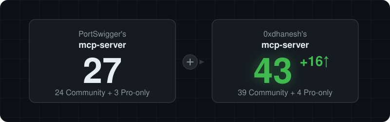

# MCP tool comparison

  

The PortSwigger column reflects the 27-tool baseline used for this comparison. The fork column reflects the 52 tools registered by the local v3.0.0 source, including the nine session and authorization tools below.

| Tool Name | Feature | PortSwigger mcp-server (✅/❌) | 0xdhanesh mcp-server (✅/❌) | How it was achieved (implementation in detail - usable for AI agents and developers to understand how it is implemented) |
| --- | --- | --- | --- | --- |
| `set_session_var` | Store a role-bound session value | ❌ | ✅ | `SessionTools.kt` writes the supplied value to the in-memory `VariableStore` under a variable name, identity, and host, then returns its `{{name}}` handle. A value supplied in MCP arguments is visible to the submitting client. |
| `extract_session_var` | Extract a session value from a response | ❌ | ✅ | `SessionTools.kt` selects the last response for the role and host, a Proxy history item, or an Organizer item. It extracts one value with JSONPath or regex and stores it without returning the value. History and Organizer access use the corresponding approval checks. |
| `acquire_session_var` | Send a token request and store its response value | ❌ | ✅ | `SessionTools.kt` sends a raw HTTP/curl request or replays a Proxy history request by ID, requires a successful response, extracts a value with JSONPath or regex, and stores it for one identity and target host. A history ID keeps login credentials out of MCP arguments. |
| `acquire_configured_session_var` | Run the token request saved in Burp | ❌ | ✅ | `SessionTools.kt` reads the saved token request profile from the MCP tab and runs its validated request and extraction settings for the supplied identity. It returns only the stored variable handle. |
| `get_session_auth_status` | Check automatic token request readiness | ❌ | ✅ | `SessionTools.kt` checks the saved request, required handles, ready roles, and selected role without sending HTTP or returning stored values. |
| `list_session_vars` | List stored session handles | ❌ | ✅ | `SessionTools.kt` enumerates names, identities, and hosts from `VariableStore`, optionally filtering by identity, without returning values. |
| `clear_session_vars` | Erase stored session values | ❌ | ✅ | `SessionTools.kt` clears all in-memory variables or only those for the requested identity. |
| `send_with_vars` | Send a request with role-bound handles | ❌ | ✅ | `SessionTools.kt` expands `{{name}}` handles in a raw HTTP/1.x or curl template for the selected identity and host, checks target permission, and returns a redacted response. An opted-in `allowTokenRequest` can run the saved token request after a 401 and retry once. |
| `authz_replay` | Compare authorization across roles | ❌ | ✅ | `SessionTools.kt` expands one request template for two to eight roles, sends each request, evaluates supplied or default assertions, and saves redacted evidence in Organizer. The result includes per-role verdicts and a redacted response comparison. |
| `send_http1_request` | Send HTTP/1.1 and read the response | ✅ | ✅ | `Tools.kt` checks target permission, normalizes line endings in the request line and headers without changing the body, builds a Montoya `HttpRequest`, and calls `api.http().sendRequest`. The fork passes the returned text through `ResponseEnd.kt` so an optional end marker can identify or truncate the displayed response. |
| `send_http2_request` | Send HTTP/2 and read the response | ✅ | ✅ | `Tools.kt` orders HTTP/2 pseudo-headers, adds regular headers and body separately, checks target permission, and calls `api.http().sendRequest` with `HttpMode.HTTP_2`. The fork also applies `ResponseEnd.kt` to the returned response. |
| `create_repeater_tab` | Open an HTTP/1.1 request in Repeater | ✅ | ✅ | Upstream builds a Montoya request and calls `api.repeater().sendToRepeater`. The fork uses `BurpActions.openRepeaterTab` to create the tab without sending, record its request and name in `RepeaterSession`, optionally write Notes through `RepeaterUi`, and restore the previously selected Burp view. |
| `create_repeater_tab_http2` | Open an HTTP/2 request in Repeater | ✅ | ✅ | `Tools.kt` builds the request from pseudo-headers, headers, and body. The fork passes it to `openRepeaterTab` with `HttpMode.HTTP_2`, which registers the tab in `RepeaterSession` and leaves sending to `send_repeater_request`. |
| `send_repeater_request` | Send a named Repeater tab and read its response | ❌ | ✅ | `BurpActions.issueRepeaterTab` resolves the tab from `RepeaterSession`. When Burp is in active manual use, the Burp HTTP API sends the request without changing the selected tab; its response is returned to MCP but does not fill the Repeater response pane. Otherwise `RepeaterUi.trySend` can click Send and read the response pane. A caller can also update the request, notes, and response markers. |
| `get_repeater_tab` | Inspect an MCP-created Repeater tab | ❌ | ✅ | `BurpActions.describeRepeaterTab` reads the stored tab's request, HTTP mode, connection ID, notes, end marker, and last response from `RepeaterSession`; `ResponseEnd.kt` formats the response if a marker was set. |
| `list_repeater_tabs` | List MCP-created Repeater tabs | ❌ | ✅ | `BurpActions.listRepeaterTabs` enumerates the in-memory `RepeaterSession` map and reports each tab's name, mode, connection ID, notes, and marker. This lists tabs opened by MCP, not every manual Repeater tab. |
| `set_repeater_notes` | Write or append Repeater notes | ❌ | ✅ | `Tools.kt` updates the tab's stored notes, then `RepeaterUi.trySetNotes` locates the matching Repeater tab and writes its Notes editor; it reports when only the session copy could be saved. |
| `set_repeater_response_end_marker` | Save a response end marker for a tab | ❌ | ✅ | `Tools.kt` stores or clears the marker and truncation flag in `RepeaterSession`. Later Repeater sends and tab reads call `ResponseEnd.presentResponse`, which finds the marker, reports its offsets, and optionally stops output at that point. |
| `send_proxy_history_to_repeater` | Move a Proxy history item into Repeater | ❌ | ✅ | `Tools.kt` finds the exact Proxy history ID through Montoya, chooses the final request when available, copies notes if requested, and calls `openRepeaterTab`. With `sendNow`, it then calls `issueRepeaterTab` and returns the fresh response. |
| `send_recorded_request_to_repeater` | Replay a Proxy or captured request | ❌ | ✅ | `Tools.kt` branches on `source`: Proxy IDs come from `api.proxy().history`, while capture IDs come from `CapturedHttpRequests`. After target permission is checked, it opens the selected request in Repeater and calls `issueRepeaterTab` to send it. Logger's displayed number is not a capture ID. |
| `send_to_intruder` | Open a request in Intruder | ✅ | ✅ | `Tools.kt` normalizes the HTTP/1.1 request prelude, constructs a Montoya `HttpRequest`, and calls `api.intruder().sendToIntruder` with the optional tab name. |
| `get_proxy_http_history` | Browse Proxy HTTP history | ✅ | ✅ | `Tools.kt` checks HTTP-history access, iterates `api.proxy().history()`, serializes each request and response through the schema helpers, and returns a paginated sequence. |
| `get_proxy_http_history_regex` | Search Proxy HTTP history | ✅ | ✅ | After the same access check, `Tools.kt` compiles the supplied regular expression and calls `api.proxy().history { it.contains(pattern) }`, then serializes matching items for pagination. |
| `get_proxy_http_history_summary` | Read compact Proxy history summaries | ❌ | ✅ | `Tools.kt` reads permitted history, optionally filters by regex, and maps each item through `BurpActions.proxyHistorySummaryLine`. Each JSON line contains the Proxy ID, time, method, URL, status, notes, and edited flag. |
| `get_proxy_http_history_item` | Read one Proxy history item by ID | ❌ | ✅ | `Tools.kt` checks HTTP-history access, locates the exact ID with `BurpActions.findProxyHistoryItem`, and serializes its request, response, and annotations. |
| `list_captured_http_requests` | List requests captured across Burp tools | ❌ | ✅ | `CapturedHttpRequests` is a Montoya `HttpHandler` that records request message IDs, source tool, and a request snapshot on send or response. Its synchronized bounded map keeps the newest 500; `Tools.kt` returns recent IDs, methods, and URLs. |
| `list_logger_requests` | Read Logger rows and comments | ❌ | ✅ | Montoya does not expose Logger's visible row numbers. `LoggerUi` activates Logger in the Swing suite window, identifies the active table by its columns, reads the displayed `#`, Tool, request fields, status, and Comment, then restores the previous Burp view. `Tools.kt` paginates the current Logger view. |
| `set_logger_comment` | Edit a Logger row's Comment | ❌ | ✅ | `LoggerUi` activates Logger, finds one visible row with the requested displayed `#`, edits its Comment cell, commits the editor, and reads the saved value back. It refuses missing or ambiguous rows and restores the previous Burp view; `Tools.kt` checks captured-request access first. |
| `set_proxy_history_notes` | Add notes and highlights to Proxy history | ❌ | ✅ | `BurpActions.annotateProxyHistory` selects an item by ID or regex, updates Montoya annotations with `setNotes` and optional `setHighlightColor`, and supports appending. It rejects a selection that would affect every item or more than 100 regex matches without an exact ID. |
| `get_proxy_websocket_history` | Browse Proxy WebSocket history | ✅ | ✅ | `Tools.kt` checks WebSocket-history access, iterates `api.proxy().webSocketHistory()`, serializes each message, and exposes a paginated result. |
| `get_proxy_websocket_history_regex` | Search Proxy WebSocket history | ✅ | ✅ | `Tools.kt` compiles a regex, uses `api.proxy().webSocketHistory { it.contains(pattern) }`, and serializes the matching messages after the access check. |
| `get_organizer_items` | Browse Organizer items | ✅ | ✅ | `Tools.kt` checks Organizer access, iterates `api.organizer().items()`, serializes each item, and paginates the result. |
| `get_organizer_items_regex` | Search Organizer items | ✅ | ✅ | `Tools.kt` compiles a regex, filters with `api.organizer().items { it.contains(pattern) }`, serializes matches, and paginates them. |
| `output_project_options` | Export Burp project settings | ✅ | ✅ | `Tools.kt` calls `api.burpSuite().exportProjectOptionsAsJson`; when credential filtering is enabled, it passes the JSON through `filterConfigCredentials` before returning it. |
| `output_user_options` | Export Burp user settings | ✅ | ✅ | `Tools.kt` calls `api.burpSuite().exportUserOptionsAsJson` and applies the same optional credential filtering. |
| `set_project_options` | Import Burp project settings | ✅ | ✅ | `Tools.kt` checks the extension's configuration-editing switch and, only when enabled, calls `api.burpSuite().importProjectOptionsFromJson` with the supplied JSON. |
| `set_user_options` | Import Burp user settings | ✅ | ✅ | `Tools.kt` checks the same configuration-editing switch and calls `api.burpSuite().importUserOptionsFromJson` when enabled. |
| `set_task_execution_engine_state` | Pause or resume Burp tasks | ✅ | ✅ | `Tools.kt` sets `api.burpSuite().taskExecutionEngine().state` to Montoya's `RUNNING` or `PAUSED` state according to the requested boolean. |
| `set_proxy_intercept_state` | Turn Proxy Intercept on or off | ✅ | ✅ | `Tools.kt` calls `api.proxy().enableIntercept()` or `disableIntercept()` according to the requested state. |
| `get_active_editor_contents` | Read the active message editor | ✅ | ✅ | `Tools.kt` checks that the current keyboard focus owner is a `JTextArea` inside Burp's suite window, then returns its text; otherwise it reports that no editor is active. |
| `set_active_editor_contents` | Replace active editor text | ✅ | ✅ | The same focus-owner lookup finds the editor. `Tools.kt` checks `isEditable` before assigning text and reports when no editable editor is active. |
| `url_encode` | URL-encode text | ✅ | ✅ | `Tools.kt` delegates to Montoya's `api.utilities().urlUtils().encode`. |
| `url_decode` | URL-decode text | ✅ | ✅ | `Tools.kt` delegates to Montoya's `api.utilities().urlUtils().decode`. |
| `base64_encode` | Base64-encode text | ✅ | ✅ | `Tools.kt` delegates to Montoya's `api.utilities().base64Utils().encodeToString`. |
| `base64_decode` | Base64-decode text | ✅ | ✅ | `Tools.kt` delegates to Montoya's `api.utilities().base64Utils().decode` and converts the bytes to text. |
| `generate_random_string` | Generate random text | ✅ | ✅ | `Tools.kt` calls Montoya's `api.utilities().randomUtils().randomString` with the requested length and character set. |
| `get_scanner_issues` | List Scanner findings, Professional only | ✅ | ✅ | When Burp reports the Professional edition, `Tools.kt` registers this tool; it reads `api.siteMap().issues()`, serializes issues, and paginates the result. |
| `generate_collaborator_payload` | Generate Collaborator payloads, Professional only | ✅ | ✅ | Both revisions use Montoya Collaborator. The fork's `CollaboratorClients` restores or creates one persisted client so later polling sees its payloads; `Tools.kt` can attach custom data, omit server location, or use Burp's default generator for a tab-linked payload. |
| `get_collaborator_interactions` | Poll Collaborator, Professional only | ✅ | ✅ | Both revisions call Montoya `getInteractions` or `getAllInteractions`. The fork polls the persisted MCP client and can filter by payload ID, payload string, or DNS/HTTP/SMTP type before serializing results; tab-linked payloads remain in Burp's Collaborator tab. |
| `get_collaborator_client` | Inspect or restore the MCP Collaborator client, Professional only | ❌ | ✅ | `CollaboratorClients` caches one client and saves its secret in extension project data. `Tools.kt` reports the server and secret, or restores a supplied secret with `api.collaborator().restoreClient` and saves it for later polls. |
| `list_extension_tools` | Discover commands from other Burp extensions | ❌ | ✅ | `ExtensionProbe.kt` reads names from Burp's Extensions table and sends a probe through `api.http().sendRequest` with known command headers (`X-ATOR-Command: status` and `X-Burp-Mcp-Discover: tools`) or a supplied header. It parses JSON tool lists when an extension answers. |
| `call_extension_command` | Call a compatible extension command | ❌ | ✅ | `Tools.kt` checks HTTP request permission, then `ExtensionProbe.probeExtension` builds a request with the specified command header and optional body, sends it through Burp's HTTP API, and returns the extension response or a no-answer message. |
