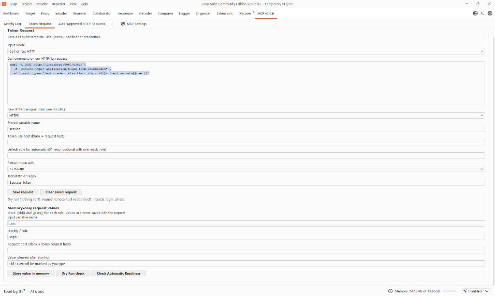
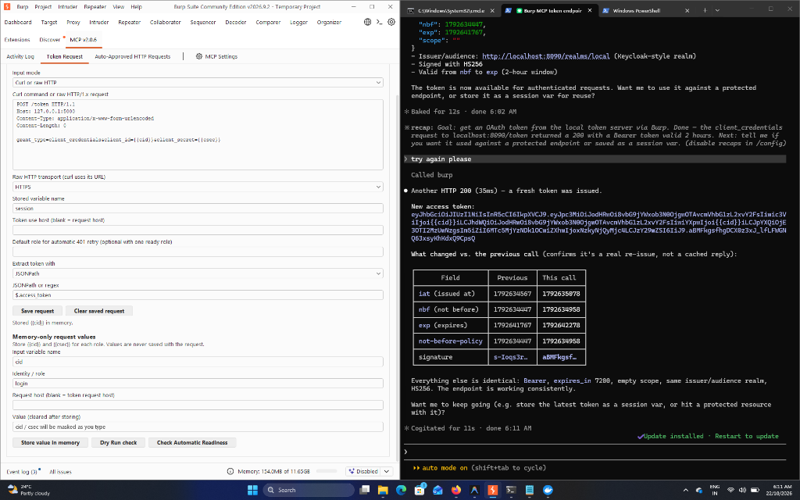

# Using the token request feature

This guide covers the **Token Request** section in Burp's **MCP** tab. It saves a reusable login request, extracts a token from its response, and stores that token under a role such as `user` or `admin`. Saved requests contain `{{name}}` placeholders; credential values and extracted tokens stay in memory.

## 1. Load the extension

Load `build/libs/burp-mcp-all-v3.0.6.jar` in **Burp > Extensions**. If an older copy is already loaded, reload the extension so the updated MCP tab appears. Open **MCP > Token Request**.

## 2. Enter the token request

Choose one input mode. These examples call `http://127.0.0.1:5000/token` and expect a JSON response containing `access_token`. Replace the address and parameter names with those used by your application. Keep credential values as placeholders in the saved request.



### Curl

Choose **CURL** under **Input mode: CURL / raw HTTP** and paste:

```bash
curl -X POST http://127.0.0.1:5000/token \
  -H "Content-Type: application/json" \
  -d '{"username":"{{username}}","password":"{{password}}"}'
```

The curl URL selects HTTP or HTTPS. Multiline commands with backslash continuations are supported.

### Raw HTTP

Choose **HTTP** under **Input mode: CURL / raw HTTP** and paste:

```http
POST /token HTTP/1.1
Host: 127.0.0.1:5000
Content-Type: application/json

{"username":"{{username}}","password":"{{password}}"}
```



Select **Use HTTPS for raw HTTP requests** for a TLS endpoint. Omit `Content-Length` from the raw template. The extension adds the UTF-8 byte length after it expands the placeholders, or recalculates a numeric length already in the template. Older saved HTTP-fields profiles load as CURL commands in the new editor.

Keep JSON field names exactly as the token issuer expects. The handle names may differ: `{"username":"{{usrname}}","password":"{{pwd}}"}` is valid when `usrname` and `pwd` are the memory-only input variable names for that role. Changing the JSON keys to `usrname` and `pwd` would send different fields to the issuer.

## 3. Set the extraction and save

Set **Stored variable name** to `session`. Select **JSONPath** under **Extract token with**, and enter `$.access_token` in **JSONPath or regex**. Click **Save request**. If several roles will have complete login values, set **Default role for automatic 401 retry** to the role the ordinary MCP HTTP tools should use, then save again. With exactly one ready role, the default can stay blank.

Leave **Token use host** blank when the token will be sent to the same host as the login request. If the token endpoint and API differ, enter the API host there, for example `api.example.test`. Enter a host name only, without a scheme, port, or path.

The saved request persists in Burp extension data. It cannot contain literal credential values in its body, query, or credential headers. Standard `grant_type` values such as `password` may be literal.

The **Configured token request and roles** section shows the last saved method, endpoint, Content-Type, JSON body keys and their handle bindings, plus each role's stored and missing input handle names. It also shows whether a session handle exists at the token-use host and whether required inputs were stored at another host. Click **Refresh configured items** after an MCP tool changes session variables. This view never displays stored values. `None (ready to request)` means the required handles exist; it does not prove the issuer will accept the username and password. If the issuer returns 401, compare the displayed JSON keys and handle bindings with the issuer contract, then re-enter that role's values from the private fixture.

## 4. Store the input values for each role

In **Memory-only request values**, make one entry for each placeholder:

1. Enter `username` as **Input variable name**, `admin` as **Identity / role**, and the actual username in **Value**. Click **Store value in memory**.
2. Repeat with `password` as the variable name and the actual password as the value.
3. Repeat both entries with identity `user` for the lower privilege account.

Leave **Request host** blank to use the token request host, `127.0.0.1` in these examples. If you fill it in, use the token request host, not the API host. The value field is masked and cleared after storing. Each role has its own `{{username}}` and `{{password}}` values.

Enter actual login values in the masked **Value** field. `{{username}}` and `{{password}}` belong in the request template only; the extension rejects them as stored values. Choose role aliases distinct from account names, such as `guest_role` and `admin_role`. If an account name is also a role name, the output redactor may display that role name as `{{username}}`; this is redaction, not evidence that a placeholder was sent.

## 5. Acquire and use the token

By default, `send_http1_request`, `send_http2_request`, and `send_with_vars` never call the saved token endpoint. They return the original HTTP 401. To permit token acquisition for a particular send, pass `"allowTokenRequest":true`. When a default role is set, or exactly one role has all inputs required by the saved token request, the extension then runs the saved token request internally, stores the token, adds it to the retry, and returns the retry response. This applies only to opted-in MCP HTTP tool sends for the configured token use host. It does not change Proxy, Repeater, or other extension traffic. If acquisition fails or the retry also returns 401, there is no further retry. The tool result notes whether acquisition was skipped or attempted. Click **Check 401 readiness** in Burp or call `get_session_auth_status` from an MCP client to check the role and missing handles without sending a request.

If a saved default role lacks its login inputs but exactly one other role is ready, the automatic 401 path selects that ready role. If several roles are ready, set the intended default role explicitly.

The configured token endpoint **is called internally only for opted-in sends** or explicit acquisition tools. For a pentest that forbids all `/token` requests, omit `allowTokenRequest` (or set it to `false`) and do not call `acquire_configured_session_var` or `acquire_session_var` for that endpoint. Leave the saved request in Burp if you need it later. To collect an unauthenticated baseline, also omit the `Authorization` header from the request itself.

For explicit role control, ask the MCP client to call `acquire_configured_session_var` once per role:

```json
{"identity":"admin"}
```

```json
{"identity":"user"}
```

The tool sends the saved request on demand, requires a successful HTTP response, extracts `access_token`, and returns the `{{session}}` handle. It does not return the token value.

To send an API request as a role, call `send_with_vars` with a request to the **Token use host**:

```json
{
  "identity": "user",
  "request": "curl http://127.0.0.1:5000/me -H 'Authorization: Bearer {{session}}'"
}
```

The extension substitutes the token only while sending the request and redacts stored values from the tool result. `list_session_vars` shows names, identities, and hosts without values. Use `clear_session_vars` to erase all in-memory values or those for one identity. **Clear saved request** removes the persistent request template; it does not replace clearing session variables.
To allow a refresh after 401 in this example, add `"allowTokenRequest":true` to the tool arguments. Without it, `send_with_vars` returns the 401 response and does not contact the configured token endpoint.

If just one role has every handle required by the request, omit `identity` and `send_with_vars` will select that role. This is useful when a username such as `dev` is redacted inside the displayed role name `developer`, producing `{{username}}eloper`; that displayed text is not a valid identity to pass back. The unredacted role name still works if you know it.

For a raw request with a relative path on a nonstandard HTTP port, set `"usesHttps":false`. For example, `GET /api/status HTTP/1.1` with `Host: 127.0.0.1:5000` needs that field. A curl request beginning `curl http://127.0.0.1:5000/...` selects HTTP from its URL and does not need `usesHttps`. If the field is omitted for raw HTTP on a nonstandard port, the tool now stops with a transport error before sending.

## Troubleshooting

| Symptom | What to check |
| --- | --- |
| **Could not save** or **JSON values must use variable handles** | Replace literal username, password, and other parameter values with `{{name}}` placeholders. Store the values in **Memory-only request values**. |
| `$.access_token` entered but no token is extracted | Select **JSONPath**, not **Regex**, and check that the response has an `access_token` JSON key. |
| Raw HTTP request to port 5000 fails to connect | Choose **HTTP** as input mode and leave **Use HTTPS for raw HTTP requests** unchecked when the endpoint is not using TLS. |
| An MCP HTTP request returns `TOKEN_MISSING` and no token request runs | This is the default. If a token request is allowed, pass `"allowTokenRequest":true`, click **Check 401 readiness** or call `get_session_auth_status`, and store any missing inputs in memory. Set a default role if several roles are ready. The API request host must match **Token use host**. |
| An echoed path such as `/api/admin` appears as `/api/{{username}}` | A stored value matched part of the displayed path and was redacted. The original path was sent. Use `send_with_vars` when you actually want to send a `{{name}}` placeholder. |
| Claude says `{{session}}` or `{{username}}` means credentials were unresolved | Tool output is redacted. A successful token acquisition means the configured request was expanded and the token response passed extraction. Check the selected role with `get_session_auth_status`; to prove a role-specific authorization issue, store separate low-privilege and admin accounts under distinct role aliases and test both. Never paste credentials into the MCP conversation. |
| **Unknown variable or identity/host mismatch** | Store every input placeholder for the identity passed to the tool and for the token request host. For API requests, bind `{{session}}` to the API host with **Token use host**. |
| `{{username}}eloper` appears as the role, or `send_with_vars` reports an identity mismatch | The output redactor masked the stored value `dev` inside `developer`. Pass the original role name `developer`, or omit `identity` when only one role has the needed handles. Do not pass the redacted display text as an identity. |
| Raw `send_with_vars` request to port 5000 gives **No HTTP response** | Set `"usesHttps":false`, or use a curl request with an `http://` URL. Raw requests with an absolute URL already carry their scheme. |
| MCP Activity Log says **No tool calls yet** | Saving the form is a Burp UI action. The log receives entries after an MCP tool call such as `acquire_configured_session_var`. |

Memory-only values are cleared when the extension unloads or the Burp project closes. Re-enter them after reloading the extension. For a login request already captured in Burp Proxy history, `acquire_session_var` with a `historyId` can replay that request without putting its credentials into MCP arguments.

## Activity Log display

Expand a tool call under **MCP > Activity Log** to see **Request content** (the submitted `request` or `content` field without the JSON envelope), **Response content** (the text content returned to the MCP client), and **Full communication (redacted)** (the complete tool input and result JSON). The submitted request may contain `{{session}}`; use Burp Logger to inspect the effective HTTP request. All three views and JSONL exports retain the extension's secret redaction.
